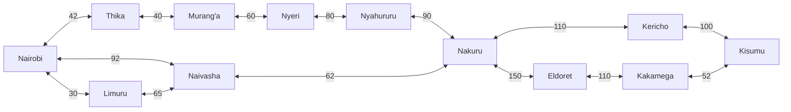
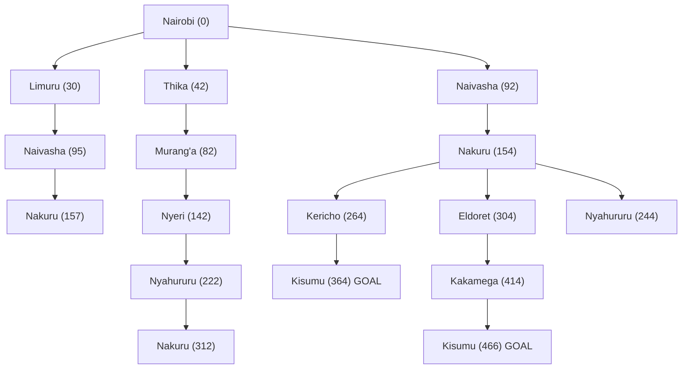

# Members
1. 190513
2. 170603
3. 171533

## Question 1: Designing the Agent

### 1.1 PEAS description

| Component | Description |
|---|---|
| **Performance measure** | Total distance covered (lower is better), delivery time, fuel consumption, cargo arriving undamaged, compliance with traffic rules, no collisions |
| **Environment** | Kenyan highways and junctions, towns along the route, other vehicles, pedestrians and animals, weather, road surface condition, traffic and roadworks |
| **Actuators** | Steering, accelerator, brakes, gear control, indicators, headlights, horn, trailer coupling and braking system |
| **Sensors** | GPS, cameras, radar and lidar, speedometer, odometer, fuel gauge, tyre pressure sensors, cargo weight sensor, rain and light sensors |

### 1.2 Environment properties

| Property | Classification | Reason |
|---|---|---|
| Observability | Partially observable | Sensors cannot see around bends, over hills or through heavy rain, and the agent cannot know what other drivers intend to do. |
| Number of agents | Multi-agent | Other drivers, matatus, motorcyclists and pedestrians act on the same road, and some of them compete for space with the trailer. |
| Determinism | Stochastic | The next state is not fully fixed by the current state and the chosen action. Traffic jams, breakdowns, accidents and weather change outcomes unpredictably. |
| Episodic or sequential | Sequential | A choice such as taking the Nakuru road affects every later decision and the total cost of the trip. |
| Static or dynamic | Dynamic | Traffic and weather keep changing while the agent is still deciding. |
| Discrete or continuous | Mixed | Route choice over towns is discrete, but speed, steering angle and position are continuous. For the searching problem we treat it as discrete. |

*Note: keep the rows that match the definitions given in class.*

### 1.3 Search problem formulation

| Element | Definition |
|---|---|
| Initial state | The trailer is at Nairobi |
| States | The trailer is located at one town in the graph |
| Actions | Drive along a highway from the current town to a directly connected town |
| Transition model | Driving from town A to town B along the link moves the trailer to B |
| Goal test | The trailer is at Kisumu |
| Path cost | Sum of the road distances (km) of the links used |

---

## Question 2: Graph and Search Tree

### 2.1 Graph of the highway network

Each town is a node. Each highway link is two directed edges, one in each direction, with the same distance as weight. In the diagram a double-headed arrow shows both directed edges. Distances are in km.

**Regions covered**

| Region | Towns |
|---|---|
| Nairobi | Nairobi, Thika, Limuru |
| Central Highlands | Murang'a, Nyeri, Nyahururu |
| Rift Valley | Naivasha, Nakuru, Eldoret, Kericho |
| Lake Victoria Basin | Kisumu, Kakamega |

### 2.2 Abstraction

The real road network contains hundreds of junctions, small trading centres, bends and road segments. We removed detail that does not change the answer to the question "which sequence of towns gives the shortest trip".

- Each town is a single state. We ignore which street or stage inside the town the trailer is on.
- Small centres between two major towns (for example Gilgil between Naivasha and Nakuru) are folded into one edge whose cost is the full driving distance.
- Roads are modelled as one edge per pair of directly linked towns. Lanes, speed limits, traffic and road quality are ignored, so cost is distance only.
- Only major towns from the four regions are kept. Dead-end side towns that cannot lie on a sensible Nairobi to Kisumu route are dropped.
- Actions are "drive to next town". Steering, braking and similar low-level control belongs to the agent's lower layer and does not appear in the search.

### 2.3 Search tree

The root is Nairobi, the initial state. Each child is a town reachable by one action. A town that already appears on the path from the root is not added again, so there are no loops. The number in brackets is the cumulative path cost g(n) in km. Kisumu nodes are goal states.

The tree is cut off below nodes whose cost already exceeds the best goal found, since expanding them cannot give a cheaper path.

---

## Question 3: Optimal Path from Nairobi to Kisumu

### 3.1 Distance table

Distances are driving distances between town centres. **The values below are approximate and must be replaced or confirmed with the Google Maps measurements the group takes.**

| From | To | Distance (km) |
|---|---|---|
| Nairobi | Thika | 42 |
| Nairobi | Limuru | 30 |
| Nairobi | Naivasha | 92 |
| Limuru | Naivasha | 65 |
| Thika | Murang'a | 40 |
| Murang'a | Nyeri | 60 |
| Nyeri | Nyahururu | 80 |
| Nyahururu | Nakuru | 90 |
| Naivasha | Nakuru | 62 |
| Nakuru | Kericho | 110 |
| Kericho | Kisumu | 100 |
| Nakuru | Eldoret | 150 |
| Eldoret | Kakamega | 110 |
| Kakamega | Kisumu | 52 |

### 3.2 Method: Uniform Cost Search

Path cost is distance, so we use Uniform Cost Search. The frontier is ordered by g(n), the cheapest node is expanded first, and the goal test is applied when a node is selected for expansion, which guarantees the first goal found is optimal.

| Step | Node expanded | g(n) | Nodes added or updated in the frontier |
|---|---|---|---|
| 1 | Nairobi | 0 | Limuru 30, Thika 42, Naivasha 92 |
| 2 | Limuru | 30 | Naivasha via Limuru would be 95, which is worse than 92, so it is kept at 92 |
| 3 | Thika | 42 | Murang'a 82 |
| 4 | Murang'a | 82 | Nyeri 142 |
| 5 | Naivasha | 92 | Nakuru 154 |
| 6 | Nyeri | 142 | Nyahururu 222 |
| 7 | Nakuru | 154 | Kericho 264, Eldoret 304, Nyahururu via Nakuru 244 (worse than 222, ignored) |
| 8 | Nyahururu | 222 | Nakuru via Nyahururu 312 (worse than 154, ignored) |
| 9 | Kericho | 264 | Kisumu 364 |
| 10 | Eldoret | 304 | Kakamega 414 |
| 11 | Kisumu | 364 | **Goal selected for expansion, search stops** |

### 3.3 Candidate routes to Kisumu

| Route | Total distance (km) |
|---|---|
| Nairobi, Naivasha, Nakuru, Kericho, Kisumu | 92 + 62 + 110 + 100 = **364** |
| Nairobi, Limuru, Naivasha, Nakuru, Kericho, Kisumu | 30 + 65 + 62 + 110 + 100 = 367 |
| Nairobi, Naivasha, Nakuru, Eldoret, Kakamega, Kisumu | 92 + 62 + 150 + 110 + 52 = 466 |
| Nairobi, Thika, Murang'a, Nyeri, Nyahururu, Nakuru, Kericho, Kisumu | 42 + 40 + 60 + 80 + 90 + 110 + 100 = 522 |

### 3.4 Result

The optimal path is

**Nairobi → Naivasha → Nakuru → Kericho → Kisumu**

with a total path cost of **364 km** (using the distances in the table above).

---

## Team Evidence

